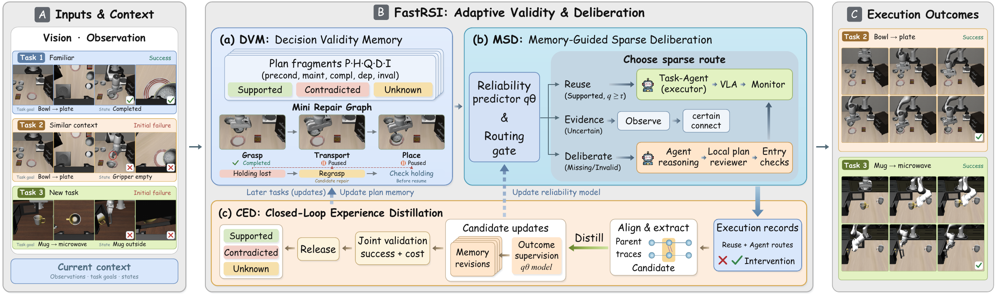

<p align="center">
  
</p>

<h1 align="center">FastRSI</h1>
<h3 align="center">Fast Recursive Self-Improvement for Embodied Agents</h3>

<p align="center">
  Ziying Song<sup>1,†</sup> · Yuchen Liu<sup>2,†</sup> · Zhuoran Xu<sup>3,†</sup> · Lin Liu<sup>4,†</sup> · Lei Yang<sup>1,*</sup><br>
  <sup>1</sup>Nanyang Technological University · <sup>2</sup>North University of China<br>
  <sup>3</sup>PsiBot · <sup>4</sup>Dalian University of Technology<br>
  <sup>†</sup>Equal contribution · <sup>*</sup>Corresponding author
</p>

<p align="center">
  <a href="https://modaxiansheng.github.io/FastRSI/"></a>
  <a href="https://github.com/modaxiansheng/FastRSI"></a>
  <a href="https://huggingface.co/pumpkin601/FastRSI-final-weights"></a>
  <a href="https://huggingface.co/datasets/pumpkin601/FastRSI-artifacts"></a>
  <a href="reproduction/START_HERE.md"></a>
</p>

<p align="center">
  <a href="#overview">Overview</a> · <a href="#method">Method</a> · <a href="#released-evaluation-snapshot">Results</a> · <a href="#quick-start">Quick Start</a> · <a href="#repository-layout">Documentation</a>
</p>

## Overview

**Reuse valid decisions. Deliberate when needed. Learn from execution.**

FastRSI studies how accumulated experience can make long-horizon embodied decisions more efficient. Its framework connects reusable plan fragments, validity-aware reasoning, and feedback-driven updates, so an agent can retain useful progress while revising decisions whose conditions no longer hold.

This repository provides frozen evaluation code, selected dependency source, configuration and provenance records, and a versioned guide to the associated weights and experiment artifacts. The released evaluation snapshot below documents a recovery-enabled system with fixed experience; it does not evaluate the complete learned FastRSI loop.

## Method

<p align="center">
  
</p>

*Conceptual framework from the FastRSI manuscript. The illustrated execution outcomes explain the intended workflow; they do not establish measured transfer performance.*

| Component | Role |
| --- | --- |
| **Decision Validity Memory (DVM)** | Represents reusable plan fragments with preconditions, stage dependencies, and invalidation conditions, preserving valid decisions and localizing repairs. |
| **Memory-Guided Sparse Deliberation (MSD)** | Combines current observations, memory validity, and a fast reliability predictor to choose reuse, evidence acquisition, or high-level reasoning. |
| **Closed-Loop Experience Distillation (CED)** | Converts execution-validated solutions into memory revisions and supervision for the predictor that governs future reuse. |

## Released evaluation snapshot

**Original LIBERO · `success_v2` · recovery-enabled native R · 2026-10-26**

The table is generated from [ORIGINAL_LIBERO_SNAPSHOT.json](ORIGINAL_LIBERO_SNAPSHOT.json). Each cell reports physical success among completed cases, with the exact denominator. The archive contains **5,968 of 6,000 planned cases**, across four VLA backends and three suites.

| VLA backend | LIBERO-Spatial | LIBERO-Object | LIBERO-Goal |
| --- | ---: | ---: | ---: |
| OpenVLA | 86.6% (433/500) | 87.8% (439/500) | 76.7% (359/468) **partial** |
| π₀ | 100.0% (500/500) | 100.0% (500/500) | 100.0% (500/500) |
| π₀.₅ | 100.0% (500/500) | 100.0% (500/500) | 100.0% (500/500) |
| X-VLA | 98.4% (492/500) | 98.4% (492/500) | 99.8% (499/500) |

OpenVLA Goal contains **468 of 500** planned cases. Its 32 missing cases are incomplete and are not counted as failures. Their identities are recorded in [PENDING_CASE_INDEX.jsonl](reproduction/PENDING_CASE_INDEX.jsonl).

This snapshot uses bounded recovery and **no cross-episode learning**. The frozen plan permits up to five native replans and six physical attempts. It is separate from the manuscript's LIBERO-10 system comparison and does not establish a shared-budget comparison with other systems. See the [restore guide](reproduction/START_HERE.md#7-选择正确实验入口与续跑位置) and [frozen run plan](FastRSI/planning/libero_three_suites_20261024_success_v2/RUN_PLAN.json) for configuration and reporting scope.

## Quick start

### 1. Get the versioned recovery record

```bash
git clone https://github.com/modaxiansheng/FastRSI.git
cd FastRSI
git checkout backup-record-20261027-v1
```

Continue with **[Restore and Resume](reproduction/START_HERE.md)**. It specifies pinned code and data revisions, SHA-256 verification, path mapping, extraction that preserves hard links, and the completed/pending case indexes. The historical guide retains the upstream repository URLs; this repository preserves the recovery tag and source history.

### 2. Restore the resources your experiment needs

Code and documentation can be inspected without downloading model weights. For execution, follow the guide to obtain the matching resources and verify their pinned revisions:

| Resource | Contents |
| --- | --- |
| [Final weights](https://huggingface.co/pumpkin601/FastRSI-final-weights) | Six archived model groups, approximately **79.71 GB** in total: π₀, π₀.₅, X-VLA, OpenVLA LIBERO-10, OpenVLA Object, and Qwen3-VL. |
| [Experiment artifacts](https://huggingface.co/datasets/pumpkin601/FastRSI-artifacts) | Reports, completed-case records, frozen evaluation source, selected recovery studies, and runtime resources. |
| [Weight manifest](FINAL_WEIGHT_MANIFEST.json) | File identities, sizes, checksums, and model-set exclusions. |
| [Final backup guide](RESTORE_FINAL_BACKUP.md) | Model, dependency, and environment restoration details. |

Downloads are optional for browsing the project; reproducing a selected experiment requires its matching dependencies. Restricted Hugging Face resources require an account with access. OpenVLA Goal and Spatial weights are excluded from the selected model backup and must be recovered from their recorded sources before reproducing those groups.

### 3. Validate the execution environment

The archived runtime used **Linux amd64, HCU/DTK, and custom environments**. Follow the [environment restoration guidance](reproduction/START_HERE.md#6-环境恢复边界) to rebuild compatible dependencies, map paths, and validate one fixed case before launching a run. macOS can download and inspect the archive; running the archived Linux binaries requires a compatible Linux environment. A fresh-machine experiment rerun is not part of the archive's completed verification.

## Repository layout

| Path | Contents |
| --- | --- |
| [`FastRSI/planning/`](FastRSI/planning/) | Frozen evaluation and selected bounded-recovery configurations, source bundles, and receipts. |
| [`FastRSI/third_party/`](FastRSI/third_party/) | Selected dependency source retained with the archived versions. |
| [`reproduction/`](reproduction/) | Pinned recovery record, verification tool, path and environment metadata, and case indexes. |
| [`docs/`](docs/) | Project page and manuscript-derived visual assets. |
| [`ORIGINAL_LIBERO_SNAPSHOT.json`](ORIGINAL_LIBERO_SNAPSHOT.json) | Machine-readable counts for the released evaluation snapshot. |
| [`ARCHIVE_SCOPE.json`](ARCHIVE_SCOPE.json) | Included materials, exclusions, and restoration boundaries. |

The previous archive description is preserved verbatim in [ARCHIVE_README.md](ARCHIVE_README.md), including its original snapshot dates and backup notes.

## Provenance and acknowledgments

This independent repository preserves the source and recovery history from [pumpkin601/FastRSI](https://github.com/pumpkin601/FastRSI). We retain the upstream weights and artifact links, version manifests, and experiment records. Project figures come from the FastRSI manuscript.

FastRSI builds on the work of the LIBERO, PhyAgentOS, OpenVLA, OpenPI, X-VLA, and Qwen communities. Third-party source, models, and assets remain subject to their original licenses and access terms.
